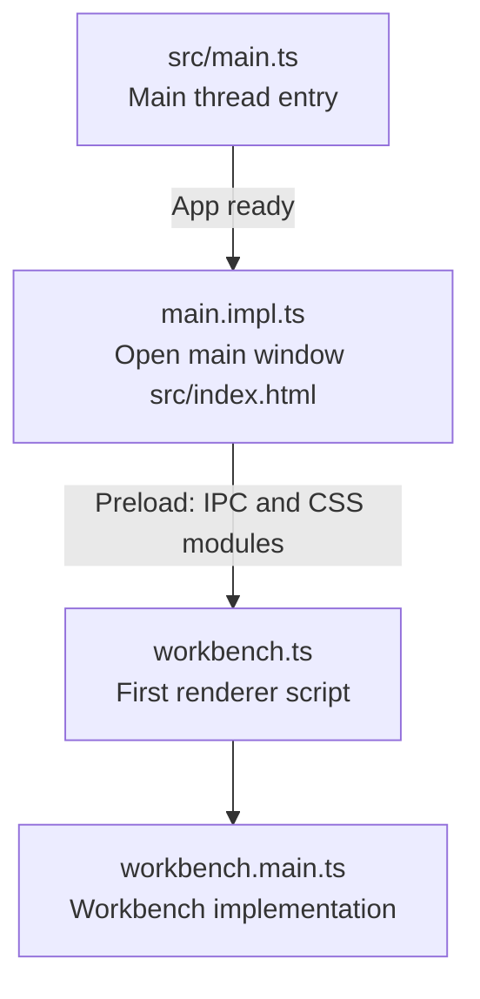

[Technically](https://github.com/hyrious/electron-zero), you can write an
Electron app with pure TypeScript with zero bundle phase. This repo tries to
prove that in practice and puts some experiments like installing itself as a
normal app/exe on macOS/Windows. Vibe-coding is allowed.

## Code Structure

This repo learns a lot from [VS Code](https://github.com/microsoft/vscode). The
most important part is codes are organized in _layers_, where layer is `common`,
`node`, `browser`, `electron-main`, `electron-browser`, etc. As you may guess,
codes in the `browser` layer must not import codes from the `node` layer. This
repo has a [local vscode extension](../.vscode/extensions/local-linter) to help
finding this kind of thing.

Full layers configuration see [`lint.config.json`](../lint.config.json).

## Application Lifecycle

The [`src/main.ts`](../src/main.ts) is the entry point of the main thread.
It does some dirty work and loads the real work in `main.impl.ts` after app ready.

The main window opens [`src/index.html`](../src/index.html) which loads
[`src/workbench/electron-browser/workbench.ts`](../src/workbench/electron-browser/workbench.ts)
as the first script. It does some dirty work and then load `workbench.main.ts`.

The [preload](../src/preload.ts) script handles the IPC and CSS modules support
through import maps. For convenient I'm using the name "vscode".
